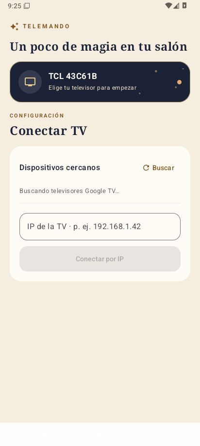
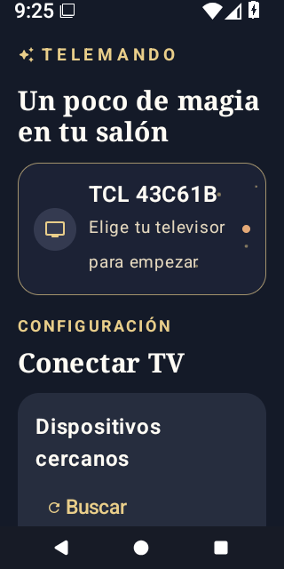

# Telemando ✦

Mando Android para una **TCL 43C61B con Google TV**. La interfaz de la televisión sigue en la TV: desde el móvil puedes navegar y escribir búsquedas. Diseño original de fantasía mágica, con tonos pergamino, tinta azul noche y detalles dorados. Se adapta al modo claro/oscuro del sistema. No contiene imágenes, nombres ni recursos oficiales de ninguna franquicia.

## Funciones

- Detectar y emparejar Google TV mediante un código mostrado en la pantalla; conectar por IP si no aparece automáticamente.
- Recordar la TV, reconectar al abrir y ofrecer reintento si falla la conexión. Tras volver de un periodo largo en segundo plano se renueva una sesión antigua; el escaneo Wi-Fi se detiene mientras la app está en segundo plano.
- Navegar con cruceta, OK, Inicio y Atrás; controlar volumen y silencio.
- Buscar desde el teclado del móvil: **Rápido** para YouTube y **Pausado** para Netflix. Telemando recuerda el método elegido y permite limpiar el texto antes de otra búsqueda.
- Tres secciones accesibles desde la barra inferior: **Mando**, **Buscar** y **Conexión**. Los controles táctiles tienen nombres accesibles; en pantallas pequeñas o con texto ampliado el mando se compacta manteniendo botones de al menos 48 dp.

### Compatibilidad comprobada

Emparejamiento, navegación, volumen, reconexión, búsqueda en YouTube (rápido) y Netflix (pausado) se probaron en la TCL 43C61B. Prime Video no acepta texto remoto en este modelo: usa la cruceta para recorrer su teclado en pantalla. RTVE Play aún no se ha probado. El diseño de conexión se comprobó en un emulador Android 36 a 320 × 640 con tamaño de fuente 160 % y modo noche, y a 412 × 915 con tamaño de fuente normal y modo claro. El usuario ha comprobado también la reconexión tras dejar la app en segundo plano más de cinco minutos en su TCL.

**No hay acceso directo a apps ni al sintonizador.** En esta TCL, el comando para abrir apps desconectaba el mando y las teclas especiales TV/Fuentes no hacían nada. Se retiraron. Usa Inicio, flechas y OK para llegar a esas funciones.

## Descargar e instalar

Descarga la **[APK pública firmada de la última versión](https://github.com/VicentBG/Telemando/releases/latest)** en un móvil Android 8.0 o superior. Si tienes instalada una APK de **debug** de las pruebas, desinstálala primero: Android no puede actualizarla con la firma de producción y perderás el emparejamiento local (vuelve a introducir el PIN de la TV). Las futuras APK públicas firmadas con la misma clave podrán actualizarse sin desinstalar. La huella SHA-256 del archivo y de su certificado figuran en las notas de cada versión.

Para compilar desde código, abre el proyecto en Android Studio con **JDK 17** y **Android SDK 36** y ejecuta `app`, o genera una APK de desarrollo:

```sh
./gradlew :app:testDebugUnitTest :app:assembleDebug
```

La APK de desarrollo se crea en `app/build/outputs/apk/debug/app-debug.apk` (no se incluye en Git). Con depuración USB puedes instalarla con `adb install -r app/build/outputs/apk/debug/app-debug.apk`. Para compilar y publicar una versión firmada consulta [la guía de publicación](docs/RELEASING.md).

Móvil y TV deben estar en la **misma red local**, sin aislamiento entre clientes ni VPN que bloquee la red. Selecciona la TV detectada o introduce su IP desde los ajustes de red de Google TV. Introduce el código que aparece en la pantalla de la TV. Para buscar, abre un campo de búsqueda **en la TV** y después usa la pestaña Buscar del móvil.

## Capturas

Pantalla de conexión en emulador, sin una TV real asociada:

 

## Tecnología y privacidad

Aplicación Kotlin / Jetpack Compose. Descubrimiento DNS-SD `_androidtvremote2._tcp.` y protocolo Android TV Remote v2 por TLS (emparejamiento 6467, control 6466). El certificado de la TV se fija tras validar el PIN. Las credenciales y la última TV se almacenan en los datos privados de la app, se excluyen de copias de seguridad y **no se incluyen en el repositorio**. No hay servicio en la nube.

El protocolo no es una API pública y puede cambiar entre versiones de Google TV. El código de protocolo en `app/src/main/java/com/ryzen/tvremote/protocol/` está adaptado de [souravkl11/android-tv-remote](https://github.com/souravkl11/android-tv-remote), commit `fd2c033be4c1b1a9b79d9fa98111978b3d4b7cf1`, bajo Apache-2.0. Consulta `third_party/android-tv-remote/NOTICE.md` y su licencia. Este proyecto se distribuye también bajo [Apache-2.0](LICENSE).
